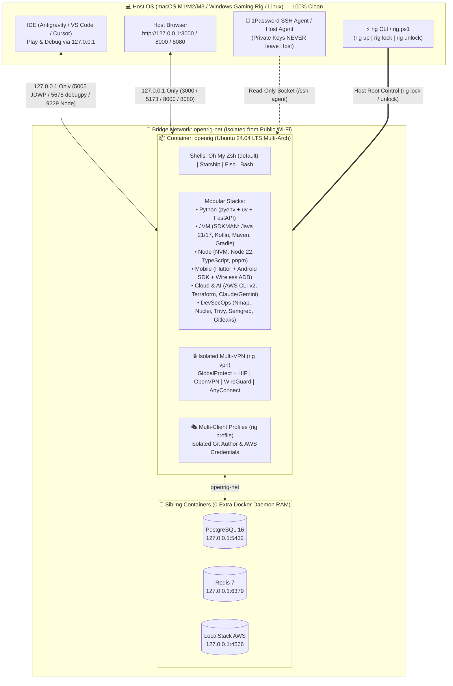
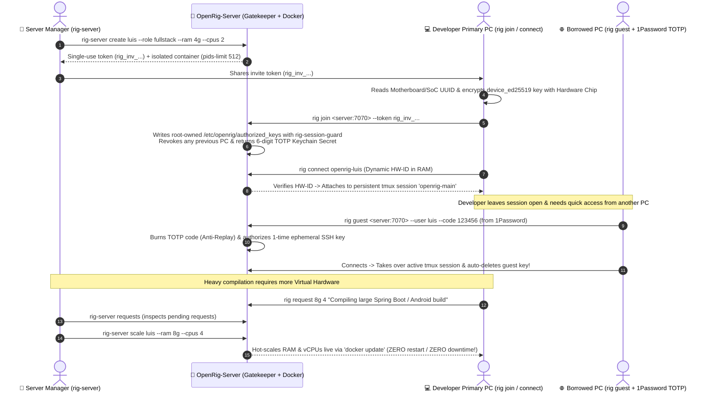

# ⚡ OpenRig — Zero-Footprint Modular Dev, Sec & AI Workstation

[](./LICENSE)
[](#)
[](./SECURITY.md)
[](#)

**OpenRig** is an open-source, security-hardened, modular workstation ecosystem in a container. It allows software engineers, tech leads, and security researchers to run complete multi-language development, mobile, cloud, AI, and penetration-testing stacks while keeping their **Host OS (macOS Apple Silicon, Windows Gaming PCs, or Linux) 100% free of SDKs, runtime daemons, VPN drivers, and package clutter**.

When you finish working, run `./rig down` to reclaim **100% of your RAM and CPU**, or `./rig uninstall` to wipe the workstation cleanly while preserving your `./workspace` code.

---

## 🏛️ Architecture & Ecosystem Overview

OpenRig operates in two complementary modes:
1. **Personal Workstation Mode (`OpenRig`)**: Runs locally on your laptop/PC (via OrbStack or Docker) with strict `127.0.0.1` port isolation, 1Password SSH Agent bridging (zero private keys inside the container), Sibling Containers (`postgres`, `redis`, `localstack`), and a Host-enforced **Anti-Malware Sandbox Switch (`rig lock` / `rig unlock`)**.
2. **Enterprise Multi-Tenant Mode ([`OpenRig-Server`](https://github.com/LFR-SnowBall/OpenRig-Server))**: Runs on a central server where the Server Manager provisions isolated containers per developer (`rig-server create`), binds access to the developer's physical Motherboard/SoC UUID (`rig join`), supports instant **Session Takeover (`tmux`)**, **Guest Keychain login via 6-digit TOTP (`rig guest`)**, and **Live Hot-Scaling of virtual RAM/CPUs without restarting sessions (`rig-server scale`)**.



---

## 🔐 Hardware-Bound Server Enrollment, Session Takeover & Live Scaling

When connecting to a central **[OpenRig-Server](https://github.com/LFR-SnowBall/OpenRig-Server)**, OpenRig enforces a **Zero-Trust Hardware-Bound Workflow**:



---

## ✨ Key Differentiators

| Feature | Command | What It Solves |
|---|---|---|
| **🎛️ Interactive Role & Module Selector** | `./rig setup` | Choose a preset role (`Backend Python`, `Backend JVM`, `Frontend`, `Mobile`, `DevSecOps`, `Full-Stack`) or toggle individual modules (`Custom`) + your favorite shell (`Oh My Zsh` default, `Starship`, `Fish`, `Bash`). |
| **📊 Monotonic Visual Progress (`0% -> 100%`)** | `./rig up` | Clean single-line progress bar with milestone checkmarks while building or starting your workstation. |
| **🧱 Anti-Malware Sandbox Switch** | `./rig lock` / `./rig unlock` | Host-enforced switch that locks `/var/run/docker.sock` (`0600 root:root`) and revokes `sudo` inside the container before you run `npm install` or `pip install` on untrusted repositories. |
| **🔒 Isolated Multi-VPN in Container** | `./rig vpn [gp\|ovpn\|wg\|anyconnect]` | Connects to corporate VPNs (**Palo Alto GlobalProtect** with HIP Report emulation, **OpenVPN**, **WireGuard**, **AnyConnect**, **Fortinet**) *inside* the container without hijacking your Host OS network. |
| **🎭 Multi-Client Identity Profiles** | `./rig profile [create\|use\|list]` | Switch Git author (`user.name`, `user.email`) and AWS credentials per client or company in 1 second with zero cross-contamination. |
| **📸 Workstation Time Machine** | `./rig snapshot [save\|restore\|export]` | Freeze your entire workstation state before an OS/library upgrade, restore it in seconds, or export it as a `.tar.gz` archive. |
| **🌐 Instant HTTPS Demo Tunnels** | `./rig share <port>` | Expose any local port inside `OpenRig` to a temporary public HTTPS URL via Cloudflare TryCloudflare for client demos or webhook testing. |
| **📱 Wireless Android Bridge** | `./rig phone [pair\|connect]` | Pair and deploy Flutter/Kotlin apps to a physical Android 11+ phone over Wi-Fi without installing Android Studio or USB drivers on your Host. |
| **🛡️ Built-in Security Audit Suite** | `./rig sec [path]` | Runs **Gitleaks** (secrets), **Trivy** (SCA vulnerabilities & IaC misconfigurations), and **Semgrep** (SAST) in a single command. |

---

## 🚀 Quickstart (macOS, Linux & Windows)

### 1. Prerequisites
- **macOS (Apple Silicon / Intel):** [OrbStack](https://orbstack.dev/) *(recommended — uses ~90% less idle RAM than Docker Desktop)* or Docker Desktop.
- **Windows 10/11:** Docker Desktop with WSL2 backend + PowerShell (`./rig.ps1`).
- **Linux:** Docker Engine + Docker Compose plugin.

### 2. Clone & Configure Your Workstation
```bash
git clone https://github.com/LFR-SnowBall/OpenRig.git
cd OpenRig

# 1. Launch the interactive Role, Module & Shell wizard:
./rig setup

# 2. Build and start your workstation (with 0% -> 100% progress bar):
./rig up

# 3. Enter your workstation terminal:
./rig shell
```
> **💡 Global CLI Shortcut (Optional):**
> Create a symlink so you can run `rig` from any directory on your computer:
> ```bash
> mkdir -p ~/.local/bin && ln -sf "$(pwd)/rig" ~/.local/bin/rig
> ```

**On Windows (PowerShell):**
```powershell
.\rig.ps1 setup
.\rig.ps1 up
.\rig.ps1 shell
```

---

## 🛠️ Detailed Usage Guide

### 🧱 1. Anti-Malware Sandbox Mode (`rig lock` / `rig unlock`)
Before auditing third-party code or running `npm install` / `pip install` on an unfamiliar repository, jail the container from your Host terminal:
```bash
# Lock Docker socket (0600 root:root) and revoke sudo inside the container:
./rig lock

# Now inside 'rig shell', any malicious postinstall script trying to use Docker or sudo is blocked:
# -> docker ps: permission denied
# -> sudo: a password is required

# Restore privileges from your Host when finished:
./rig unlock
```

### 🐳 2. Sibling Containers (`postgres`, `redis`, `localstack`)
Start or stop backing services alongside `OpenRig` on the shared `openrig-net` bridge network:
```bash
./rig service up postgres redis localstack
./rig service down postgres redis localstack
```

### 🔒 3. Isolated Multi-VPN (`rig vpn`)
Keep your Host OS free of intrusive VPN kernel extensions:
```bash
./rig vpn gp vpn.company.com       # Palo Alto GlobalProtect (with HIP report emulation)
./rig vpn ovpn client.ovpn         # OpenVPN (.ovpn profile)
./rig vpn wg wg0.conf              # WireGuard (.conf profile)
./rig vpn anyconnect vpn.corp.com  # Cisco AnyConnect / OpenConnect
./rig vpn status                   # Inspect active tunnel interfaces & routes
./rig vpn down                     # Tear down active VPN tunnels
```

### 🎭 4. Multi-Client Identity & Cloud Profiles (`rig profile`)
```bash
./rig profile create personal "Luis Real" "luisitoreal01@gmail.com" default
./rig profile create linuxopensource "Luis Real" "lreal@linuxopensource.mx" los-aws
./rig profile use linuxopensource
./rig profile list
```

### 📸 5. Time Machine Snapshots (`rig snapshot`)
```bash
./rig snapshot save clean-sprint-1
./rig snapshot list
./rig snapshot restore clean-sprint-1
./rig snapshot export clean-sprint-1 ~/Backups/openrig-sprint1.tar.gz
```

### 🔌 6. Connecting to an `OpenRig-Server` (`rig join` / `rig connect` / `rig guest` / `rig request`)
```bash
# 1. Enroll your primary laptop (encrypts SSH key with your Motherboard UUID):
./rig join 192.168.1.100:7070 --token rig_inv_...

# 2. Connect in 1 second with automatic tmux Session Takeover:
./rig connect openrig-luis

# 3. Connect from a borrowed PC using your 6-digit 1Password TOTP Keychain (leaves zero trace):
./rig guest 192.168.1.100:7070 --user luis

# 4. Request a live Virtual RAM / vCPU upgrade from the Server Manager:
./rig request 8g 4 "Running heavy integration test suite"
```

---

## 💻 IDE Play & Debug Integration (VS Code / Antigravity / Cursor)

OpenRig includes a pre-configured [`.devcontainer/devcontainer.json`](./.devcontainer/devcontainer.json) and exposes localhost-only debug ports (`127.0.0.1`):
- **Option A (Attach to Running Container):** Open your IDE, run **Dev Containers: Attach to Running Container...**, and select `/openrig`. Hit **F5 (Play/Debug)** directly using the container's Python, Java, Node, or Flutter SDKs.
- **Option B (Remote Debug from Host IDE):** Connect your Host IDE debugger to `127.0.0.1:5005` (Java/Kotlin JDWP), `127.0.0.1:5678` (Python `debugpy`), or `127.0.0.1:9229` (Node.js Inspector).

---

## 🛡️ Security Architecture Summary

See [**SECURITY.md**](./SECURITY.md) for the complete Red-Team threat model and hardening verification:
- **Zero Public Wi-Fi Exposure:** All development, debug, and database ports bind exclusively to `127.0.0.1`.
- **Zero Private Key Mounts:** `${HOME}/.ssh` is never mounted inside the container; all Git/SSH signing flows through the read-only host `SSH_AUTH_SOCK` (1Password SSH Agent).
- **Motherboard-Encrypted Enrollment Keys:** `device_ed25519` is encrypted at rest using a passphrase derived dynamically from the host's hardware UUID (`IOPlatformUUID` / `/etc/machine-id`) via `SSH_ASKPASS`.
- **Root-Owned `authorized_keys` Guard:** In server mode, `/etc/openrig/authorized_keys` is owned by `root:root` (`0644`), preventing non-root tampering with `/usr/local/bin/rig-session-guard`.

---

## 📄 License

Released under the [**MIT License**](./LICENSE).  
Copyright © 2026 **Linux Open Source S.A. de C.V.** / **Luis Fernando Real (`LFR-SnowBall`)**.
